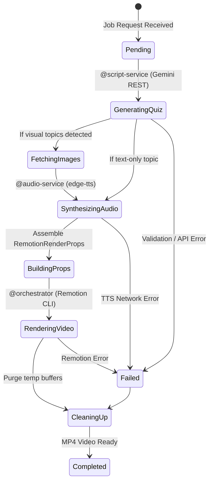

# Data Model: Quiz Shorts Generator

**Feature**: `002-quiz-shorts-generator`  
**Date**: 2026-10-10  
**Status**: Completed (Phase 1)

---

## 1. Domain Entities & Schemas

### `DifficultyTier` (Enum)
Represents the three progressive gamification tiers of the 9-question challenge.
```python
from enum import Enum

class DifficultyTier(str, Enum):
    EASY = "easy"      # Level 1: Questions 1–3 (Theme Accent: #22C55E Neon Green)
    MEDIUM = "medium"  # Level 2: Questions 4–6 (Theme Accent: #F59E0B Neon Yellow)
    HARD = "hard"      # Level 3: Questions 7–9 (Theme Accent: #EF4444 Neon Red)
```

---

### `QuizItem` (Pydantic Schema)
Represents an individual Open-Recall trivia question.

| Field | Type | Validation Rules | Description |
| :--- | :--- | :--- | :--- |
| `question_number` | `int` | `ge=1, le=9` | Sequential question index (1 to 9). |
| `difficulty` | `DifficultyTier` | Must match tier partition | Progressive difficulty level. |
| `tier_index` | `int` | `ge=1, le=3` | Tier group index (1 for Easy, 2 for Medium, 3 for Hard). |
| `question_text` | `str` | `min_length=5, max_length=150` | The question prompt presented to the viewer. |
| `correct_answer` | `str` | `min_length=1, max_length=60` | Definitive answer displayed on the reveal card. |
| `fun_fact` | `str` | `max_length=200` | Educational takeaway or punchline spoken post-reveal. |
| `image_query` | `str | None` | `default=None` | Search term for visual topics (e.g. "Flag of Brazil"). |
| `local_image_path` | `str | None` | `default=None` | Cached path to verified local image file. |

---

### `QuizTier` (Pydantic Schema)
Groups 3 questions belonging to a specific difficulty level.

| Field | Type | Validation Rules | Description |
| :--- | :--- | :--- | :--- |
| `tier_level` | `DifficultyTier` | Required | Difficulty enum value. |
| `tier_index` | `int` | `1 <= v <= 3` | Numeric level (1, 2, 3). |
| `theme_color` | `str` | Hex color code | Primary neon accent color for this level. |
| `questions` | `list[QuizItem]` | `len == 3` | Exactly 3 questions per tier. |

---

### `QuizChallenge` (Pydantic Schema)
Complete 9-question challenge dataset produced by `@script-service`.

| Field | Type | Validation Rules | Description |
| :--- | :--- | :--- | :--- |
| `topic` | `str` | `min_length=2, max_length=100` | The user's requested quiz category/topic. |
| `language` | `str` | `"ru"` or `"en"` (default: `"ru"`) | Narration language for TTS and prompts. |
| `total_questions` | `int` | `== 9` | Total questions across all tiers. |
| `tiers` | `list[QuizTier]` | `len == 3` | The 3 tiers: Easy (3), Medium (3), Hard (3). |

---

## 2. Audio & Timing Entities

### `WordCue`
Word-level alignment boundary extracted from `edge-tts` for dynamic karaoke captions.

| Field | Type | Description |
| :--- | :--- | :--- |
| `word` | `str` | Token string. |
| `start_ms` | `int` | Millisecond offset when speech of this word begins. |
| `end_ms` | `int` | Millisecond offset when speech of this word ends. |

---

### `QuestionAudioCue`
Timing breakdown for a single question cycle.

| Field | Type | Description |
| :--- | :--- | :--- |
| `question_number` | `int` | Question index (1 to 9). |
| `question_audio_file` | `str` | Path to generated question speech audio. |
| `question_duration_ms` | `int` | Duration of the question speech track. |
| `question_words` | `list[WordCue]` | Word timestamps for the question prompt. |
| `think_duration_ms` | `int` | Standard thinking timer duration (3000 ms). |
| `answer_audio_file` | `str` | Path to generated answer + fun fact speech audio. |
| `answer_duration_ms` | `int` | Duration of the answer speech track. |
| `answer_words` | `list[WordCue]` | Word timestamps for the answer narration. |
| `total_cycle_ms` | `int` | `question_duration_ms + 3000 + answer_duration_ms + padding`. |

---

### `AudioCueSheet`
Master timeline compiled by `@audio-service`.

| Field | Type | Description |
| :--- | :--- | :--- |
| `cues` | `list[QuestionAudioCue]` | Ordered list of all 9 question timing cues. |
| `total_duration_ms` | `int` | Sum of all question cycles (55,000 – 65,000 ms). |
| `total_duration_frames` | `int` | Total video frames at 60 fps (`duration_ms * 60 / 1000`). |

---

## 3. Remotion Composition Props

### `RemotionRenderProps`
The unified contract passed to Remotion CLI via JSON.
```json
{
  "challenge": {
    "topic": "Мировая география",
    "language": "ru",
    "total_questions": 9,
    "tiers": [
      {
        "tier_level": "easy",
        "tier_index": 1,
        "theme_color": "#22C55E",
        "questions": [
          {
            "question_number": 1,
            "difficulty": "easy",
            "tier_index": 1,
            "question_text": "Какая самая длинная река в мире?",
            "correct_answer": "Амазонка",
            "fun_fact": "Ее длина составляет более 6400 километров.",
            "image_query": null,
            "local_image_path": null
          }
        ]
      }
    ]
  },
  "cue_sheet": {
    "total_duration_ms": 58400,
    "total_duration_frames": 3504,
    "cues": []
  },
  "background_video_path": "assets/backgrounds/parkour_01.mp4",
  "sfx_paths": {
    "timer_tick": "assets/sfx/timer_tick.wav",
    "reveal_ding": "assets/sfx/reveal_ding.wav",
    "level_up": "assets/sfx/level_up.wav"
  },
  "fps": 60,
  "width": 1080,
  "height": 1920
}
```

---

## 4. Lifecycle & State Transitions


