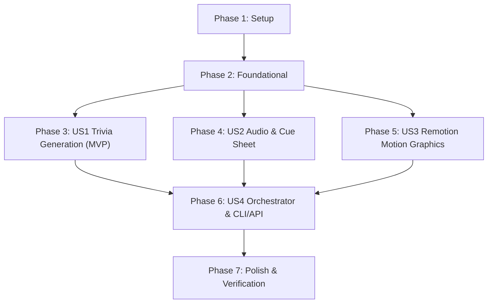

# Tasks: Automated Quiz & Trivia Shorts Generator (QuizyPeasy Style)

**Feature**: `002-quiz-shorts-generator` | **Date**: 2026-10-10 | **Plan**: [plan.md](plan.md) | **Spec**: [spec.md](spec.md)

## Phase 1: Setup (Shared Infrastructure)

**Purpose**: Project initialization, directory structure, dependency definitions, and asset scaffolding.

- [x] T001 Create project directories for quiz module in `videoanalizer/quiz/`, assets in `assets/backgrounds/` and `assets/sfx/`, and Remotion template in `templates/quiz-remotion/`
- [x] T002 [P] Update Python dependencies in `pyproject.toml` with `edge-tts>=6.1.9` and `duckduckgo_search>=4.4.0`
- [x] T003 [P] Initialize Node.js Remotion template package in `templates/quiz-remotion/package.json` with React 18, TypeScript, Tailwind CSS, and `@remotion/cli`
- [x] T004 [P] Populate curated background video loops in `assets/backgrounds/` and sound effects (`timer_tick.wav`, `reveal_ding.wav`, `level_up.wav`) in `assets/sfx/`

---

## Phase 2: Foundational (Blocking Prerequisites)

**Purpose**: Core configuration, strict Pydantic v2 contracts, contract tests, and workspace isolation that MUST be complete before ANY user story can proceed.

**⚠️ CRITICAL**: No user story implementation can begin until this phase is verified.

- [x] T005 Implement quiz configuration and Pydantic Settings in `videoanalizer/quiz/config.py` (Gemini model defaults, voice mappings, paths, render timeouts)
- [x] T006 [P] Implement Pydantic v2 domain schemas (`DifficultyTier`, `QuizItem`, `QuizTier`, `QuizChallenge`) in `videoanalizer/quiz/models.py` strictly matching `specs/002-quiz-shorts-generator/contracts/quiz-schema.json`
- [x] T007 [P] Implement audio and timing schemas (`WordCue`, `QuestionAudioCue`, `AudioCueSheet`, `RemotionRenderProps`) in `videoanalizer/quiz/models.py` strictly matching `specs/002-quiz-shorts-generator/contracts/remotion-props.json`
- [x] T008 [P] Implement schema contract unit tests in `tests/contract/quiz/test_quiz_schema_contract.py` validating Pydantic serialization against JSON schemas
- [x] T009 Implement task workspace manager with context manager cleanup in `videoanalizer/quiz/workspace.py` ensuring temporary files are purged upon completion or error

**Checkpoint**: Foundation ready - domain models, configuration, and workspace isolation verified.

---

## Phase 3: User Story 1 - 9-Question Open-Recall Trivia Generation (Priority: P1) 🎯 MVP

**Goal**: Generate a structured 9-question trivia challenge partitioned into 3 difficulty tiers (Level 1 Easy, Level 2 Medium, Level 3 Hard) via Gemini REST API using Open-Recall format, with dynamic web image search for visual topics.

**Independent Test**: Run `python -m pytest tests/unit/quiz/test_script_service.py` to verify that 9 valid questions across 3 tiers conforming to `quiz-schema.json` are returned, and visual queries download valid cached images.

### Tests for User Story 1
- [x] T010 [P] [US1] Unit test for `@script-service` in `tests/unit/quiz/test_script_service.py` mocking Gemini REST API structured outputs
- [x] T011 [P] [US1] Unit test for image search service in `tests/unit/quiz/test_image_service.py` mocking search responses and verifying text/emoji fallback

### Implementation for User Story 1
- [x] T012 [US1] Implement `@script-service` Gemini REST API client in `videoanalizer/quiz/script_service.py` generating 9 questions across 3 tiers (Easy, Medium, Hard) using `gemini-2.5-flash` with structured outputs
- [x] T013 [US1] Implement dynamic web image search and download service with local caching in `videoanalizer/quiz/image_service.py` downloading and verifying images with fallback handling
- [x] T014 [US1] Integrate image resolution into `@script-service` in `videoanalizer/quiz/script_service.py` linking verified `local_image_path` to each `QuizItem`

**Checkpoint**: User Story 1 is fully functional and testable headlessly.

---

## Phase 4: User Story 2 - Voiceover Narration & Sound Cue Sheet (Priority: P2)

**Goal**: Synthesize natural neural speech for questions and answers via `edge-tts`, extract word-level timing boundaries for karaoke subtitles, and compile a master `AudioCueSheet` with SFX triggers.

**Independent Test**: Run `python -m pytest tests/unit/quiz/test_audio_service.py` to verify speech audio files are synthesized, word-level boundaries (`WordCue`) are extracted, and a 3.0s think window and reveal ding are properly mapped.

### Tests for User Story 2
- [x] T015 [P] [US2] Unit test for `@audio-service` in `tests/unit/quiz/test_audio_service.py` verifying speech synthesis, word boundaries, and cue sheet timing calculations

### Implementation for User Story 2
- [x] T016 [US2] Implement speech synthesis and word boundary parsing via `edge-tts` in `videoanalizer/quiz/audio_service.py` extracting `WordCue` lists (`start_ms`, `end_ms`, `word`) for questions and answers
- [x] T017 [US2] Implement master cue sheet compilation in `videoanalizer/quiz/audio_service.py` calculating start frames, 3000ms think windows, reveal ding frames, and total durations for `AudioCueSheet`
- [x] T018 [US2] Implement sound effects validation helper in `videoanalizer/quiz/audio_service.py` verifying availability of `timer_tick.wav`, `reveal_ding.wav`, and `level_up.wav` in `assets/sfx/`

**Checkpoint**: User Stories 1 AND 2 are independently verifiable.

---

## Phase 5: User Story 3 - 3-Tier Motion Graphics & TikTok Karaoke Typography (Priority: P3)

**Goal**: Build the declarative Remotion video template (React 18, TypeScript, Tailwind CSS) rendering 1080x1920 60fps vertical video with neon dark glassmorphism, dynamic tier theme shifts (Green/Yellow/Red), 3.0s countdown bar, and word-by-word karaoke typography.

**Independent Test**: Run `npx remotion preview` inside `templates/quiz-remotion/` and inspect visual composition, timer bar animation, active word highlights, and answer pop-in cards.

### Implementation for User Story 3
- [x] T019 [P] [US3] Configure Remotion entry and root composition (1080x1920, 60fps) in `templates/quiz-remotion/src/Root.tsx` and `templates/quiz-remotion/remotion.config.ts`
- [x] T020 [P] [US3] Implement TypeScript interfaces in `templates/quiz-remotion/src/types.ts` strictly conforming to `contracts/remotion-props.json`
- [x] T021 [P] [US3] Implement `BackgroundLayer.tsx` in `templates/quiz-remotion/src/components/BackgroundLayer.tsx` rendering looped 9:16 background video with ambient dark overlay
- [x] T022 [P] [US3] Implement `TierHeader.tsx` in `templates/quiz-remotion/src/components/TierHeader.tsx` displaying category, level badge, counter (1/9 to 9/9), and dynamic tier theme colors (Green `#22C55E`, Yellow `#F59E0B`, Red `#EF4444`)
- [x] T023 [P] [US3] Implement `QuestionCard.tsx` in `templates/quiz-remotion/src/components/QuestionCard.tsx` rendering open-recall prompt text or aspect-ratio contained visual image
- [x] T024 [P] [US3] Implement `CountdownBar.tsx` in `templates/quiz-remotion/src/components/CountdownBar.tsx` smoothly shrinking from 100% to 0% width over 3.0 seconds at 60fps
- [x] T025 [P] [US3] Implement `KaraokeCaptions.tsx` in `templates/quiz-remotion/src/components/KaraokeCaptions.tsx` with frame-synchronized active-word neon glow highlighting
- [x] T026 [P] [US3] Implement `AnswerRevealCard.tsx` in `templates/quiz-remotion/src/components/AnswerRevealCard.tsx` with high-impact pop-in animation, green neon glow, and synchronized narration text
- [x] T027 [US3] Assemble master sequence composition in `templates/quiz-remotion/src/QuizChallenge.tsx` chaining all 9 question cycles with native `<Audio>` SFX triggers (`timer_tick`, `reveal_ding`, `level_up`)

**Checkpoint**: Visual engine and motion graphics template ready for headless rendering.

---

## Phase 6: User Story 4 - Headless Video Assembly Orchestrator & CLI/API (Priority: P4)

**Goal**: Coordinate the end-to-end pipeline via Python `@orchestrator`, serializing props, running Remotion CLI, validating the final 1080x1920 60fps MP4 video (55–65s), purging temp files, and exposing CLI/FastAPI endpoints.

**Independent Test**: Execute `python -m videoanalizer.quiz.cli --topic "Мировая география" --language "ru" --output "outputs/test_quiz.mp4"` and verify the resulting MP4 file plays with synchronized audio and clean temp cleanup.

### Tests for User Story 4
- [x] T028 [P] [US4] Unit test for `@orchestrator` in `tests/unit/quiz/test_orchestrator.py` validating pipeline coordination and Remotion CLI command construction

### Implementation for User Story 4
- [x] T029 [US4] Implement `@orchestrator` in `videoanalizer/quiz/orchestrator.py` coordinating data generation, audio synthesis, background selection, `remotion-props.json` serialization, Remotion CLI execution, and workspace cleanup
- [x] T030 [P] [US4] Implement standalone CLI entrypoint in `videoanalizer/quiz/cli.py` supporting `--topic`, `--language`, `--background`, and `--output` flags
- [x] T031 [P] [US4] Implement FastAPI routes in `videoanalizer/api/routes_quiz.py` matching `contracts/api-routes.md` for asynchronous generation and video download
- [x] T032 [US4] Register quiz routes in FastAPI application in `videoanalizer/api/__init__.py`

**Checkpoint**: Complete end-to-end pipeline runnable via CLI and REST API.

---

## Phase 7: Polish & Cross-Cutting Concerns

**Purpose**: Verification against quickstart guide, linting, formatting, type checking, and storage leak auditing.

- [x] T033 [P] Execute end-to-end validation scenarios documented in `specs/002-quiz-shorts-generator/quickstart.md`
- [x] T034 [P] Run Ruff linter and formatter across all new Python code in `videoanalizer/quiz/` and `tests/`
- [x] T035 [P] Run TypeScript type check (`tsc --noEmit`) and linter in `templates/quiz-remotion/`
- [x] T036 Resource leak audit verifying 100% cleanup of `temp/quiz_*` directories upon normal execution and simulated error

---

## Dependencies & Execution Order

### Phase Dependencies



- **Phase 1 (Setup)**: No dependencies — can start immediately.
- **Phase 2 (Foundational)**: Depends on Phase 1 — BLOCKS all user stories.
- **Phase 3 (US1)**: Can start after Phase 2.
- **Phase 4 (US2)**: Can start after Phase 2 (runs in parallel with US1).
- **Phase 5 (US3)**: Can start after Phase 2 (runs in parallel with US1 and US2).
- **Phase 6 (US4)**: Depends on US1, US2, and US3.
- **Phase 7 (Polish)**: Depends on all user stories being complete.

---

## Parallel Opportunities

```bash
# Parallel Batch 1: Setup & Foundational Schemas
Task T002: "Update pyproject.toml dependencies"
Task T003: "Initialize Node.js Remotion package.json"
Task T004: "Populate assets/backgrounds/ and assets/sfx/"
Task T006: "Implement Pydantic domain schemas in models.py"
Task T007: "Implement audio/timing schemas in models.py"

# Parallel Batch 2: Independent Sub-Services
Developer A (Script Service): T010, T011, T012, T013, T014
Developer B (Audio Service):  T015, T016, T017, T018
Developer C (Remotion UI):     T019, T020, T021, T022, T023, T024, T025, T026
```

---

## Implementation Strategy

### MVP Scope (User Story 1 Only)
1. Complete Phase 1 (Setup) and Phase 2 (Foundational).
2. Complete Phase 3 (User Story 1).
3. Validate: Run `test_script_service.py` to prove structured 9-question 3-tier trivia generation works.

### Full Feature Delivery
1. Setup + Foundational $\rightarrow$ Foundation verified.
2. US1 (Script Service) $\rightarrow$ Question generation & image search ready.
3. US2 (Audio Service) $\rightarrow$ Voiceover synthesis & word boundaries ready.
4. US3 (Remotion Template) $\rightarrow$ 9:16 60fps glassmorphism & karaoke animations ready.
5. US4 (Orchestrator & CLI/API) $\rightarrow$ End-to-end MP4 assembly ready.
6. Polish $\rightarrow$ Linting, type checking, and leak validation.
